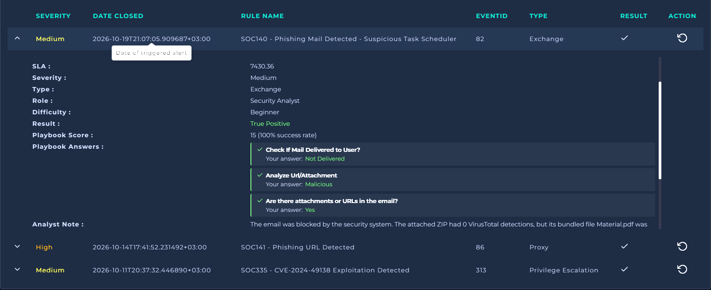
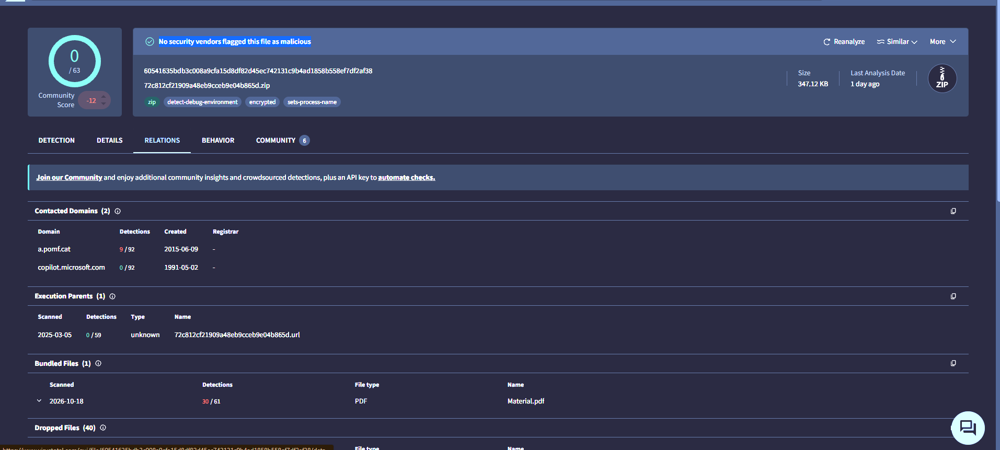

# SOC140: Phishing Mail Detected, Suspicious Task Scheduler

## Summary
A mail-security alert flagged a phishing email carrying a ZIP attachment. The
email was **blocked and never delivered** to the user. I analysed the attachment
and found <what made it malicious, in one sentence>, so I classified it as a
**true positive**.

## Alert details
| Field | Value |
|---|---|
| Rule | SOC140 - Phishing Mail Detected - Suspicious Task Scheduler |
| Event ID | 82 |
| Severity | Medium |
| Type | Exchange (email) |
| Alert time | <time from the alert details> |
| Sender | <defanged address> |
| Recipient | <user> |
| Subject | <subject line> |
| Delivery status | Blocked / not delivered |

## Investigation
1. **Alert review:** <what the alert showed, sender, recipient, attachment>
2. **Delivery check:** <how I confirmed the mail was or wasn't delivered>
3. **Attachment analysis:** <the ZIP and what it contained>
4. **Reputation check:** <hash lookups: results for the ZIP and for the file inside>
5. **Behaviour check:** <what the file tries to do, and why "Task Scheduler" matters>

## Evidence

*<what this shows>*

*<what this shows>*

## Indicators of compromise
| Type | Value |
|---|---|
| Sender address | <defanged, e.g. name[@]domain[.]com> |
| Sender IP | <defanged> |
| ZIP file name | <name> |
| Inner file | Material.pdf *(confirm against your evidence)* |
| File hashes | <SHA-256 of ZIP and inner file> |
| Reputation | <detections / total and the date you checked> |

## Timeline
| Time | Event |
|---|---|
| <time> | Email received by the mail gateway |
| <time> | Email blocked by the security system |
| <time> | Alert fired |

## Why this verdict
1. <ZIP looked clean on VirusTotal (0 detections), but the file inside was flagged>
2. <the inner file behaves like or pretends to be something it isn't>
3. <task-scheduler behaviour is a persistence technique>

## Why the clean ZIP score mattered
<One or two sentences in your own words: the outer ZIP had no detections, but
the file bundled inside it did. Checking only the container would have missed it.>

## Recommendations
- <block the sender and sender domain at the mail gateway>
- <search other mailboxes for the same sender, subject or file hash>
- <confirm no copy was delivered or opened anywhere>
- <add the file hashes to blocklists or detection rules>
- <remind users how to report suspicious attachments>

## MITRE ATT&CK
- <T1566.001 Phishing: Spearphishing Attachment>
- <T1053.005 Scheduled Task (persistence), if your evidence supports it>

## What I learned
<one or two sentences in your own words>

## What I'd do differently
<one honest line>
