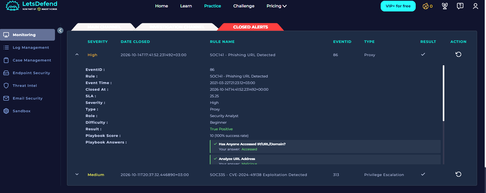
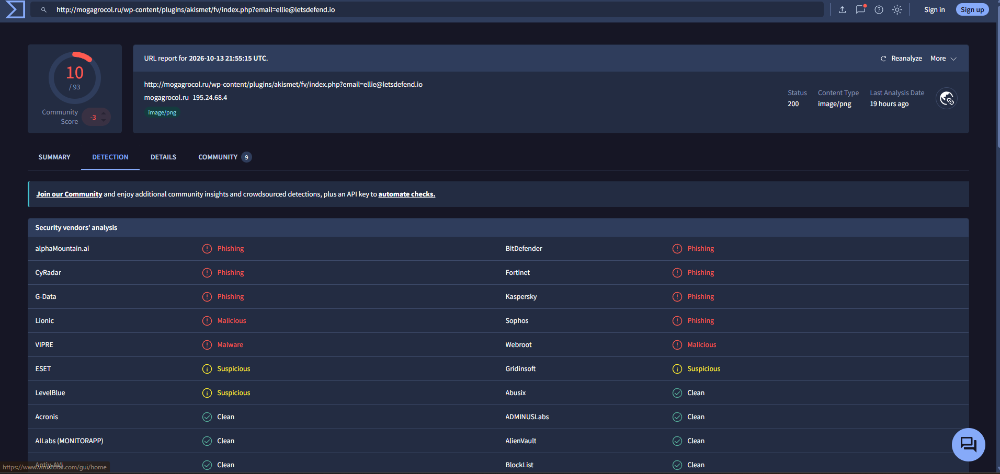
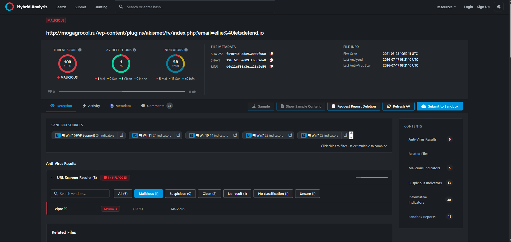

# SOC141 - Phishing URL Detected

## Summary
A SIEM alert flagged malicious because of Phishing URL Detection on **EmilyComp**.
I traced that it is a malicious URL by investing that URL on `Virus Total` and 
`Hybrid Analysis` flagged it malicious 100/100**.

## Alert details
| Field | Value |
|---|---|
| Severity | High |
| Alert time | 2021-03-22T21:23:12+03:00 |
| Affected host / user | EmilyComp |

## Investigation
1. **Alert review:** checked the url on url checking tools.
2. **Reputation check:** looked up the url on VirusTotal and hybrid analysis.
3. **Log review:** searched Log Management and Endpoint Security records and got to know that the url is accessed by the employee.

## Evidence

*How efficiently i solved the alert.*

*VirusTotal result for the URL.*

*hybrid analysis result for the URl.*

## Indicators of compromise
| Type | Value |
|---|---|
| URL name | `mogagrocol.ru` |
| Full url | `http://mogagrocol.ru/wp-content/plugins/akismet/fv/index.php?email=ellie@letsdefend.io` |

## Why It Is Malicious

1. **Threat intelligence:** VirusTotal reported 10 vendors flagging the URL as malicious.
2. **Hybrid Analysis:** The URL received a threat score of 100/100 and was classified as malicious. Its URL scanner results showed 1 of 6 scanners flagging it.
3. **Suspicious URL:** The request targeted `mogagrocol.ru/wp-content/plugins/akismet/fv/index.php`, which was identified in the phishing URL alert.
4. **Proxy evidence:** Log Management contained a matching request to the URL from source IP `172.16.17.49` to destination IP `91.189.114.8` on port 80.
5. **Access allowed:** The alert showed the device action as `Allowed`, meaning the proxy permitted the request.

## Access Investigation

The proxy log confirmed that a request to the suspicious URL was recorded. The affected user shown in the alert was `ellie`.

A recorded request does not prove that the user entered credentials or that the phishing page successfully loaded.

## Containment Status

The playbook instructed me to contain the affected machine through the EDR/Endpoint Security page. **I should only mark the machine as contained after confirming that the containment action succeeded.**

## Recommendations

- Contain or isolate the affected machine using the EDR tool.
- Block the malicious URL and domain at the proxy or web filter.
- Search other company devices for requests to the same domain.
- Check whether the user submitted credentials or downloaded any files.
- Reset the user's credentials if evidence indicates they were exposed.

## MITRE ATT&CK

- **T1566.002 — Spearphishing Link:** Relevant if the URL was delivered to the user through a phishing message.
- **T1204.001 — Malicious Link:** Relevant if the user clicked the link.

*These techniques are possible mappings; the logs reviewed so far do not independently prove how the user received or interacted with the URL.*

## What I Learned

I learned how to investigate a phishing URL by checking reputation services, examining proxy logs, identifying the source and destination IP addresses, and checking whether the request was allowed or blocked. I also learned that a suspicious URL being accessed does not automatically mean the user was compromised.

## What I'd Do Differently

I would inspect the full proxy log and establish the request timeline first, then use threat-intelligence tools to support the investigation and determine whether further evidence of compromise exists.
