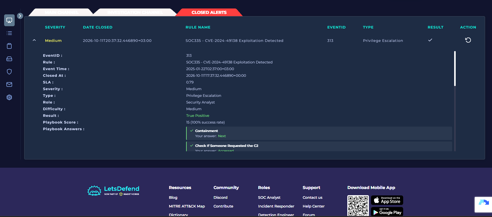
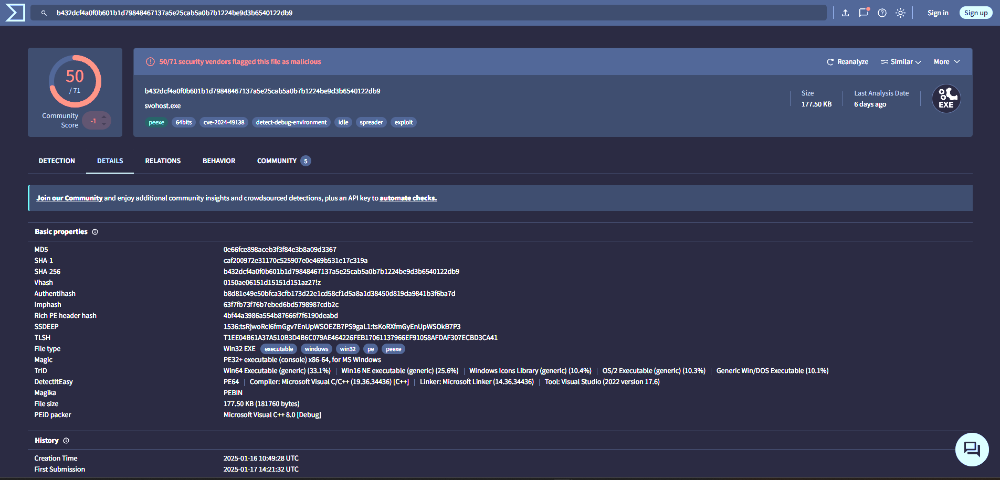

# SOC335: CVE-2024-49138 Exploitation Detected

## Summary
A SIEM alert flagged possible exploitation of CVE-2024-49138 on host **Victor**.
I traced it to a malicious executable, `svhost.exe`, that imitates the legitimate
Windows process `svchost.exe` and runs from a temp directory. I classified the
alert as a **true positive**.

## Alert details
| Field | Value |
|---|---|
| Rule | SOC335 - CVE-2024-49138 Exploitation Detected |
| Event ID | 313 |
| Severity | Medium |
| Alert time | <date and time from the alert> |
| Affected host / user | Victor |

## Investigation
1. **Alert review:** read the rule, host and file details.
2. **File inspection:** checked the file name, its path and the process that launched it.
3. **Reputation check:** looked up the file hash on VirusTotal.
4. **Log review:** searched Log Management and Endpoint Security records for network activity and execution.

## Evidence

*The alert showing the rule, host and file path.*

*VirusTotal result for the file hash.*

## Indicators of compromise
| Type | Value |
|---|---|
| File name | `svhost.exe` |
| File path | `C:\temp\service_installer\svhost.exe` |
| Parent / related process | `powershell.exe` |
| VirusTotal | <detections/total, with the date you checked> |
| C2 / download source | <defanged URL, e.g. hxxps://...[.]com/...> |

## Timeline
| Time | Event |
|---|---|
| <time> | Host contacted the download source |
| <time> | `svhost.exe` written to `C:\temp\service_installer\` |
| <time> | Process executed |
| <time> | Alert fired |

## Why it is malicious
1. **Wrong name:** `svhost.exe` imitates the real `svchost.exe` (masquerading, MITRE T1036).
2. **Wrong location:** the real file lives in `C:\Windows\System32`, not `C:\temp`.
3. **Reputation:** flagged malicious by multiple vendors on VirusTotal.
4. **Behaviour:** it was launched alongside PowerShell, and the logs show the host
   reached the download source.

## Containment status
The file was **not quarantined** at the time of the alert, so the threat was still active.

## Recommendations
- Isolate host Victor from the network
- Block the download source and related addresses at the firewall or proxy
- Search other hosts for the same file hash and for contact with the same address
- Remove the file and review how it got onto the machine
- Reset credentials for the affected user if there are signs of compromise

## MITRE ATT&CK
- T1036 Masquerading
- T1068 Exploitation for Privilege Escalation

## What I learned
`svchost.exe` is a real Windows process that hosts services, so attackers copy its
name. I now check the exact spelling, the file path and the parent process before
trusting any process that looks familiar.

## What I'd do differently
<one honest line, e.g. check the logs for the full timeline before checking VirusTotal>
